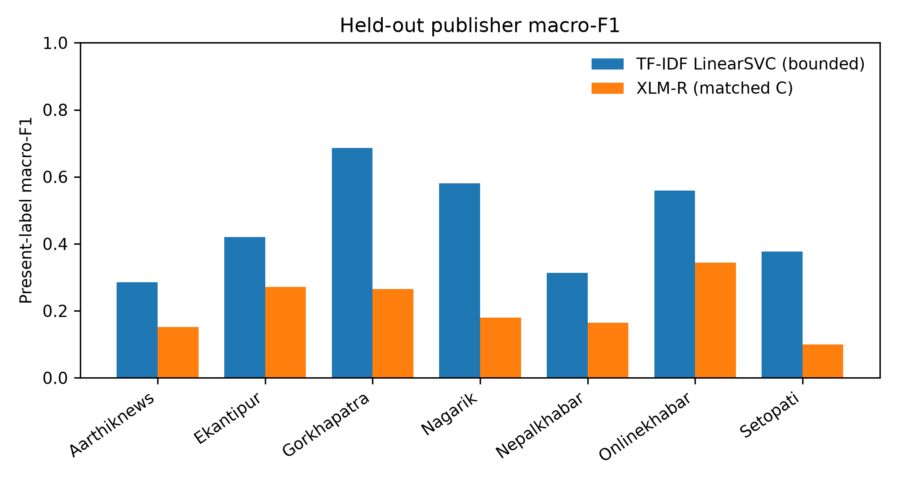
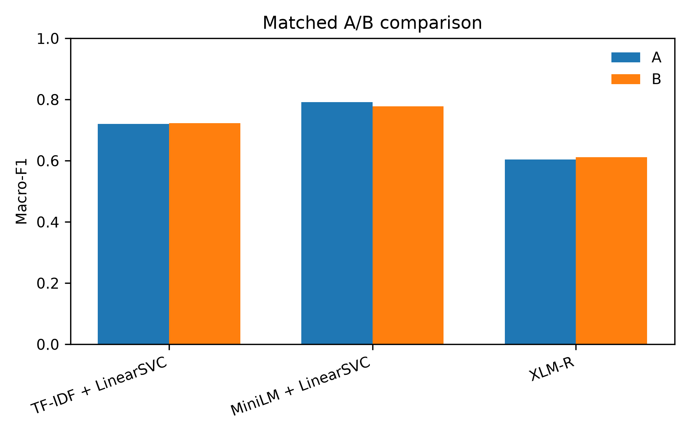
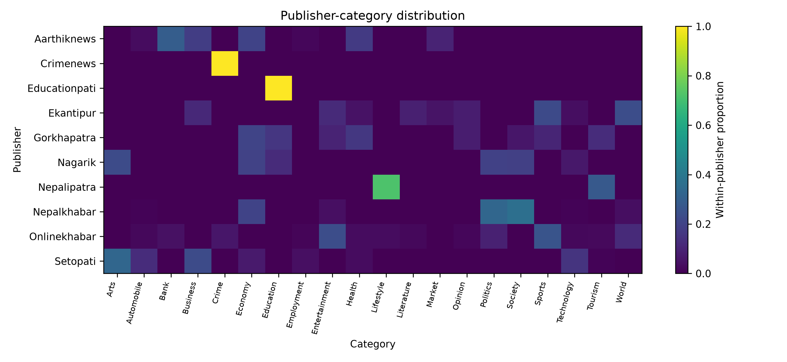

# Nepali News Topic Classification Under Publisher Shift
[](https://doi.org/10.5281/zenodo.24053390)

Reproducible research on whether Nepali news-topic classifiers generalize
when the publisher changes.

## TL;DR

- **Problem:** evaluate Nepali topic classification without treating a random
  split as evidence of publisher generalization.
- **Finding:** the frozen TF-IDF reference reaches **0.7504 macro-F1** on the
  fixed test partition. The held-out-publisher diagnostic averages **0.4605**
  and ranges from **0.2851 to 0.6864**, but uses a different bounded model and
  present-label metric; it is not a strict before/after drop.
- **Why it matters:** an ordinary random split allowed **156 duplicate groups**
  to cross partitions; the fixed duplicate-aware partitions allow **zero**.
- **Additional evidence:** a source-only probe reaches **0.7385 accuracy**,
  showing that publisher identity is strongly associated with the labels.

## Live demo

**[Try the Nepali News Classifier on Hugging Face](https://huggingface.co/spaces/Nisxal/nepali-news-demo)**

The demo loads the saved TF-IDF, MiniLM, and XLM-R serving artifacts when
available. It reports startup time, per-model latency, top-3 predictions,
agreement, text warnings, and score semantics. TF-IDF shows calibrated
probabilities; MiniLM shows raw margins; XLM-R shows uncalibrated softmax
scores.

## Paper

**Technical report:** in preparation.

## Research question and protocol

How well do Nepali news classifiers generalize to unseen publishers, and how
much of the apparent performance is associated with duplicate exposure,
publisher/category association, source-related text, imbalance, and model
choice?

Dataset: [`Suyogyart/np20ng`](https://huggingface.co/datasets/Suyogyart/np20ng).
The study uses content only, fixed train/validation/test assignments, seed 42,
and a test-once rule: validation selects models and policies; the untouched
test partition is evaluated only after selection.

| Partition | Rows |
|---|---:|
| Train | 138,711 |
| Validation | 46,237 |
| Test | 46,238 |

The dataset contains 231,216 raw rows, 231,186 usable rows, 20 categories, and
10 publishers. Exact normalized duplicate groups do not cross the fixed
partitions. The partitions are not guaranteed to be fully near-duplicate-safe.

## Results

### Frozen fixed-partition test

This is the principal reference result: word TF-IDF unigrams/bigrams with
`min_df=2`, `max_features=300000`, `sublinear_tf=True`, and
`LinearSVC(C=1.0)`. It was evaluated once on the untouched test set.

| Metric | Score |
|---|---:|
| Accuracy | **0.7850** |
| Macro-F1 | **0.7504** |
| Weighted-F1 | **0.7816** |

Accuracy bootstrap 95% CI: `[0.7813, 0.7885]`; macro-F1 bootstrap 95% CI:
`[0.7453, 0.7553]`. Source:
[`results/tables/final_test_metrics.json`](results/tables/final_test_metrics.json)
and [`notes/classical_benchmark.md`](notes/classical_benchmark.md).

### Matched-budget comparison

These experiments use the same 50,000-train / 10,000-validation /
10,000-test budget. They are not directly comparable with the full
fixed-partition reference.

| Model | Matched A macro-F1 | Matched B macro-F1 |
|---|---:|---:|
| TF-IDF + LinearSVC | 0.7208 | 0.7234 |
| MiniLM + LinearSVC | 0.6046 | 0.6120 |
| XLM-R | **0.7921** | 0.7782 |

XLM-R used one epoch and one seed (42), maximum length 256, learning rate
`2e-5`, batch size 4, and gradient accumulation 4.
Source: [`results/tables/matched_50k_ab_degradation.csv`](results/tables/matched_50k_ab_degradation.csv).

A planned three-seed extension was attempted locally but did not complete
within the available run; no seed-sweep result is reported here.

### Publisher-held-out diagnostic

Seven eligible publishers were evaluated with a bounded 10,000-feature TF-IDF
configuration and present-label macro-F1. This is a descriptive source-shift
diagnostic; category coverage differs by publisher.

| Quantity | Value |
|---|---:|
| Mean macro-F1 | 0.4605 |
| Standard deviation | 0.1506 |
| Publisher range | 0.2851–0.6864 |



### Additional diagnostics

| Diagnostic | Result |
|---|---|
| Random split duplicate groups crossing partitions | 156 |
| Fixed duplicate-aware split crossing groups | 0 |
| Source-only probe | 0.7385 accuracy; 0.6677 macro-F1 |
| Calibrated test ECE | 0.0209 |
| Abstention threshold | 0.2932 on maximum calibrated probability |
| Accepted test coverage | 0.9836 |
| Accepted test accuracy | 0.7942 |

The source-only probe is a diagnostic, not a replacement for content
classification. Sources:
[`explanations/research_handoff.md`](explanations/research_handoff.md),
[`results/tables/calibration_abstention_metrics.json`](results/tables/calibration_abstention_metrics.json),
and [`results/tables/random_vs_grouped_metadata.json`](results/tables/random_vs_grouped_metadata.json).





## Validation-only LLM pilot

This was a separate zero-shot, labels-only pilot on 100 validation rows, not a
main result. The majority baseline was `0.13`; the predeclared go/no-go
threshold was accuracy `>= 0.35`.

| Model | Accuracy | Macro-F1 | Weighted-F1 |
|---|---:|---:|---:|
| Qwen2.5-3B-Instruct, 4-bit | 0.19 | 0.1141 | 0.1823 |
| Gemma 3 4B IT, 4-bit | 0.29 | 0.1524 | 0.2454 |

The stage stopped below the threshold. No test articles, few-shot inference,
or cross-publisher LLM evaluation was run.

## Repository layout

| Path | Purpose |
|---|---|
| [`src/`](src/) | Classical, neural, matched-budget, audit, and analysis scripts |
| [`results/`](results/) | Saved metrics, figures, split metadata, and diagnostics |
| [`tests/`](tests/) | Research pipeline tests |
| [`notes/`](notes/) | Protocol, report, LLM, and reproduction documentation |
| [`explanations/`](explanations/) | Current research handoff and interpretation |
| [`app/`](app/) | Gradio demo, serving bundles, tests, and Space metadata |

The dataset, caches, and large training checkpoints are not required to clone
the code repository. Saved split metadata and result tables document completed
experiments; the fixed processed partitions are required to rerun training.

## Setup and exact reproduction commands

Commands below run from the repository root. They preserve existing split
assignments; they do not silently regenerate them.

### Research environment

PowerShell:

```powershell
py -3.13 -m venv .venv
.\.venv\Scripts\python.exe -m pip install --upgrade pip
.\.venv\Scripts\python.exe -m pip install -r requirements-neural.txt
.\.venv\Scripts\python.exe -m pip install pytest pandas scikit-learn scipy joblib pyarrow
```

Linux/macOS:

```bash
python3.13 -m venv .venv
. .venv/bin/activate
python -m pip install --upgrade pip
python -m pip install -r requirements-neural.txt
python -m pip install pytest pandas scikit-learn scipy joblib pyarrow
```

Run tests:

```powershell
.\.venv\Scripts\python.exe -m pytest tests -q
```

```bash
python -m pytest tests -q
```

Reproduce the principal classical diagnostics:

```powershell
.\.venv\Scripts\python.exe src\classical_benchmark.py --experiment final-test
.\.venv\Scripts\python.exe src\classical_benchmark.py --experiment source-held-out
.\.venv\Scripts\python.exe src\classical_benchmark.py --experiment random-grouped
.\.venv\Scripts\python.exe src\classical_benchmark.py --experiment source-text
.\.venv\Scripts\python.exe src\classical_benchmark.py --experiment conflicts
```

```bash
python src/classical_benchmark.py --experiment final-test
python src/classical_benchmark.py --experiment source-held-out
python src/classical_benchmark.py --experiment random-grouped
python src/classical_benchmark.py --experiment source-text
python src/classical_benchmark.py --experiment conflicts
```

Run focused neural/matched checks:

```powershell
.\.venv\Scripts\python.exe -m pytest tests\test_day8_neural.py -q
.\.venv\Scripts\python.exe -m pytest tests\test_matched_budget.py -q
```

```bash
python -m pytest tests/test_day8_neural.py -q
python -m pytest tests/test_matched_budget.py -q
```

The LLM pilot is not part of the default reproduction run. Its protocol and
saved results are in [`notes/llm_protocol.md`](notes/llm_protocol.md).

## Demo setup and reproduction

The demo is a separate Gradio application under [`app/`](app/). Its pinned
requirements are in [`app/requirements.txt`](app/requirements.txt).

From the repository root:

```powershell
.\.venv\Scripts\python.exe -m pip install -r app\requirements.txt
.\.venv\Scripts\python.exe -m pytest app\test_app.py app\test_real_models.py -q
.\.venv\Scripts\python.exe app\app.py
```

```bash
python -m pip install -r app/requirements.txt
python -m pytest app/test_app.py app/test_real_models.py -q
python app/app.py
```

The demo loads models once at startup and isolates failures by model. TF-IDF
uses the saved calibrated bundle; MiniLM uses the saved LinearSVC bundle plus
the named sentence-transformer encoder; XLM-R uses the local deployment copy
when present and otherwise falls back to `MODEL_REPO_ID` in
[`app/config.py`](app/config.py). User text is not intentionally logged or
stored. Do not submit private or sensitive text.

## Limitations

- Labels are automatically assigned and may be noisy.
- Exact duplicate groups are protected across fixed partitions, but the split
  is not fully near-duplicate-safe.
- Publisher and category distributions are associated, so source-held-out
  scores are descriptive rather than causal.
- The source-held-out analysis covers seven eligible publishers.
- MiniLM and XLM-R comparisons use different protocols; XLM-R uses one epoch
  and one seed.
- Calibration is fit on validation data and may not transfer to unseen
  publishers or future data.
- The LLM pilot covers two small 4-bit models, one prompt, and 100 validation
  rows. It supports no general claim about LLMs for Nepali.
- The repository does not currently declare a separate code-license file.
  Check the dataset card and model licenses before redistribution.

## Further reading

- [`notes/paper_pack.md`](notes/paper_pack.md) — report-ready numbers and
  source paths
- [`notes/evaluation_protocol.md`](notes/evaluation_protocol.md) — split,
  leakage, metrics, and test-once protocol
- [`notes/final_report.md`](notes/final_report.md) — report narrative
- [`explanations/research_handoff.md`](explanations/research_handoff.md) —
  comprehensive experiment handoff
- [`app/README.md`](app/README.md) — Space-specific metadata and deployment
  details
