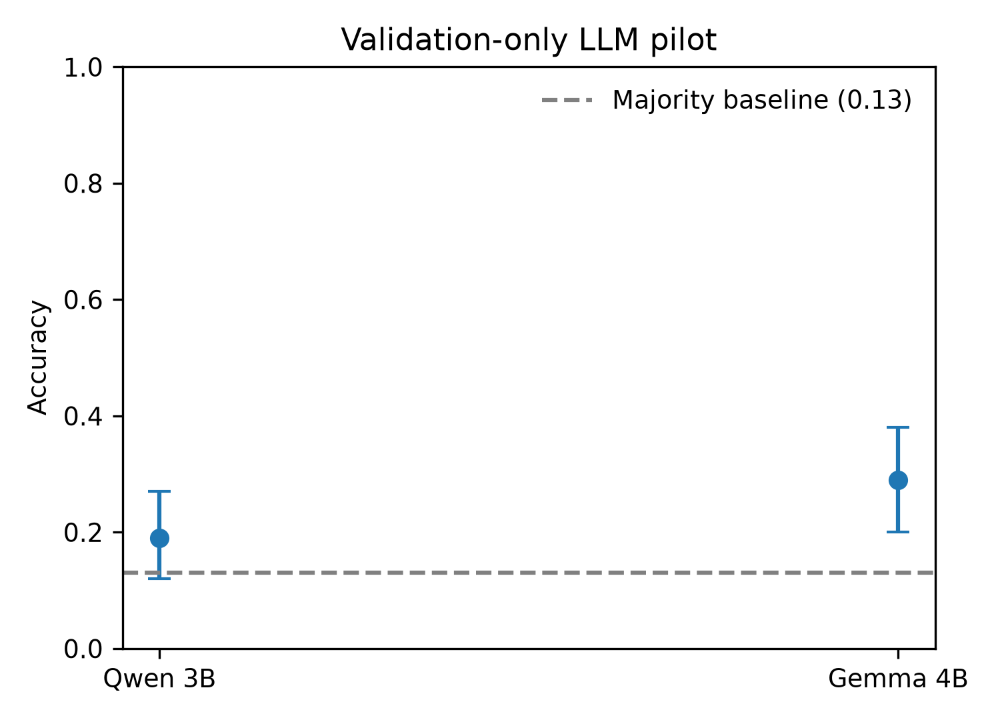

# Nepali News Topic Classification

Reproducible experiments on **Nepali news classification under publisher
shift** using the [`Suyogyart/np20ng`](https://huggingface.co/datasets/Suyogyart/np20ng)
dataset.

## Live demo

Try the Gradio demo:
**[Nepali News Classifier](https://huggingface.co/spaces/Nisxal/nepali-news-demo)**

The demo accepts Nepali text and shows predictions from the saved TF-IDF,
MiniLM, and XLM-R models when available.

## Main result

The frozen reference is word-level TF-IDF with unigrams and bigrams followed
by `LinearSVC(C=1.0)`. It was evaluated once on the untouched fixed test set.

| Model / evaluation | Accuracy | Macro-F1 | Weighted-F1 |
|---|---:|---:|---:|
| TF-IDF reference — fixed test | **0.7850** | **0.7504** | **0.7816** |
| MiniLM + LinearSVC — fixed test | 0.7114 | 0.6288 | 0.6979 |
| XLM-R — matched A test | **0.8364** | **0.7921** | **0.8356** |
| XLM-R — matched B test | 0.8220 | 0.7782 | 0.8204 |

Matched A/B results use the same 50,000-train / 10,000-validation /
10,000-test budget. They should not be treated as directly interchangeable
with the full fixed-fold reference.

## Publisher-shift result

The held-out-publisher diagnostic shows that performance varies substantially
across publishers. It uses a bounded 10,000-feature TF-IDF model and
present-label macro-F1.


Mean present-label macro-F1 across seven held-out publishers: **0.4605**
(SD **0.1506**).

## Additional results

### Matched evaluation


### Category distribution


## Dataset and protocol

- 231,216 raw rows; 231,186 usable rows
- 20 categories and 10 publishers
- Content-only input
- Fixed duplicate-aware partitions: 138,711 train / 46,237 validation /
  46,238 test
- Seed: 42
- Exact normalized duplicate groups do not cross the fixed partitions
- The final test partition is evaluated only after model selection

## Models

- **TF-IDF + LinearSVC:** 300,000 maximum word unigram/bigram features,
  `min_df=2`, `sublinear_tf=True`, `C=1.0`
- **MiniLM:** `paraphrase-multilingual-MiniLM-L12-v2` embeddings with
  LinearSVC
- **XLM-R:** one-epoch `xlm-roberta-base` matched-budget experiment,
  maximum length 256, seed 42

The demo labels scores honestly: TF-IDF displays calibrated probabilities,
MiniLM displays raw margins, and XLM-R displays softmax scores that are not
calibrated.

## LLM pilot (validation only)

This was a separate zero-shot, labels-only pilot on a fixed 100-row validation
subset. Articles were truncated to the first 400 model tokens. The majority
baseline was **0.1300**, and the predeclared go/no-go threshold was accuracy
**>= 0.35**.

| Model | Accuracy | Macro-F1 | Weighted-F1 | Accuracy 95% CI |
|---|---:|---:|---:|---:|
| Qwen2.5-3B-Instruct, 4-bit | 0.1900 | 0.1141 | 0.1823 | unavailable |
| Gemma 3 4B IT, 4-bit | 0.2900 | 0.1524 | 0.2454 | [0.2000, 0.3800] |

Neither model met the threshold, so the LLM stage stopped. No test articles,
few-shot inference, or cross-publisher LLM evaluation was run. These results
do not support general claims about LLM performance on Nepali.



Saved result sources: [`results/tables/llm_bakeoff_status.json`](results/tables/llm_bakeoff_status.json),
[`results/tables/llm_gemma_bakeoff_metrics.json`](results/tables/llm_gemma_bakeoff_metrics.json),
and [`notes/llm_protocol.md`](notes/llm_protocol.md).

## Limitations

Labels are automatic and may be noisy. The partitions are exact-duplicate-aware
but not fully near-duplicate-safe. XLM-R uses one epoch and one seed, and the
publisher analysis covers seven eligible publishers. The stopped LLM pilot
used two small 4-bit models on 100 validation rows only; it is not evidence
about LLMs generally.

## Repository

| Path | Purpose |
|---|---|
| [`src/`](src/) | Experiment and analysis scripts |
| [`results/`](results/) | Saved metrics, figures, and artifacts |
| [`notes/`](notes/) | Protocols, research notes, and handoff documentation |
| [`app/`](app/) | Gradio demo and serving bundles |
| [`tests/`](tests/) | Research pipeline tests |

## Reproduction

Install the research environment, then run the focused tests:

```powershell
.\.venv\Scripts\python.exe -m pytest tests -q
```

Run the local demo:

```powershell
.\.venv\Scripts\python.exe app\app.py
```

See [`notes/evaluation_protocol.md`](notes/evaluation_protocol.md) for the
evaluation rules and [`app/README.md`](app/README.md) for demo deployment
details.

## License and data

Check the dataset card and redistribution terms before publishing article
text. The public demo uses user-provided text and does not intentionally store
submissions.
