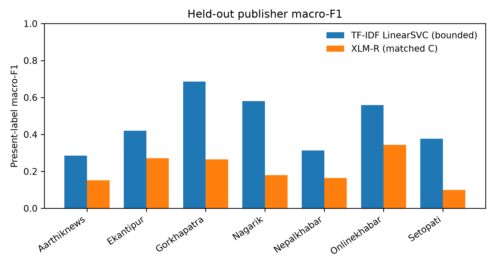

# Nepali News Topic Classification

Interactive demo for a reproducible study of Nepali news-topic
classification under publisher shift.

**Live Space:** <https://huggingface.co/spaces/Nisxal/nepali-news-demo>

**Technical report:** [arXiv link to be added](<ARXIV_REPORT_URL>)

The demo accepts Nepali article text and displays predictions from three saved
models when their artifacts are available:

- **TF-IDF + LinearSVC:** calibrated probabilities and a validated abstention
  flag.
- **MiniLM + LinearSVC:** raw margin scores, explicitly **not probabilities**.
- **XLM-R matched-A:** softmax scores, explicitly **not calibrated**.

The application loads models once at startup, reports load times, shows
per-model latency, and keeps model failures isolated so one unavailable model
does not disable the others.

## Research question

How well do Nepali news classifiers generalize when the publisher changes, and
how do duplicate-aware evaluation, classical features, multilingual sentence
embeddings, and a matched-budget multilingual transformer compare?

## Headline results

The frozen reference is a word-level TF-IDF model with unigram and bigram
features followed by `LinearSVC(C=1.0)`. It was evaluated once on the
untouched fixed test partition.

| Model / evaluation | Accuracy | Macro-F1 | Weighted-F1 |
|---|---:|---:|---:|
| Frozen TF-IDF reference, fixed test | **0.7850** | **0.7504** | **0.7816** |
| MiniLM + LinearSVC, full fixed test | 0.7114 | 0.6288 | 0.6979 |
| XLM-R, matched A test | 0.8364 | 0.7921 | 0.8356 |
| XLM-R, matched B test | 0.8220 | 0.7782 | 0.8204 |

The matched A/B rows use a controlled 50,000-train / 10,000-validation /
10,000-test budget. A permits ordinary random duplicate leakage; B uses the
duplicate-aware matched condition. These numbers are not directly comparable
with the full fixed-fold reference or the held-out-publisher diagnostic.

## Cross-publisher diagnostic

The following figure shows the bounded 10,000-feature TF-IDF diagnostic and
matched-C XLM-R present-label macro-F1 by held-out publisher. Category
coverage differs by publisher, so this is descriptive evidence of source
shift, not a significance test.



The bounded TF-IDF diagnostic had mean present-label macro-F1 **0.4605**
(standard deviation **0.1506**) across seven held-out publishers. The
publisher-level values ranged from **0.2851** to **0.6864**.

## Dataset and protocol

The study uses the `Suyogyart/np20ng` Nepali news dataset:

- 231,216 raw rows
- 231,186 usable rows after empty-content filtering
- 20 topic categories
- 10 publishers
- content-only model input
- fixed duplicate-aware train/validation/test partitions:
  138,711 / 46,237 / 46,238 rows
- seed 42
- test partition evaluated only after model selection

Exact normalized duplicate groups do not cross the fixed partitions. The
partitions are not fully near-duplicate-safe; that limitation is retained in
the research interpretation.

## Demo features

### Research tab

- Research question and headline findings
- Frozen test metrics
- Held-out-publisher comparison
- Source-shift figure
- LLM pilot scope note
- Limitations and links when configured

### Try it tab

- Nepali text input
- Predict, clear, and original example controls
- One result card per available model
- Predicted category and top-three categories
- Correct score semantics for each model
- Per-model latency
- TF-IDF uncertainty flag at the validated threshold
- Agreement summary
- Text length, Devanagari-character count, and truncation warning
- Privacy and research-use disclaimer

User-submitted text is not intentionally logged or stored. Do not submit
private, confidential, or sensitive text.

## Model details

### Frozen TF-IDF reference

```text
TfidfVectorizer(
    ngram_range=(1, 2),
    min_df=2,
    max_features=300000,
    sublinear_tf=True,
)
LinearSVC(C=1.0)
```

The saved bundle also contains the validation-fitted multiclass calibrator.
The uncertainty threshold is **0.29319883795485374**, applied to the maximum
calibrated probability. It is not applied to raw SVM margins.

### MiniLM

`sentence-transformers/paraphrase-multilingual-MiniLM-L12-v2` produces
384-dimensional normalized embeddings. The saved LinearSVC classifier reports
raw decision margins. Those margins are not calibrated probabilities.

### XLM-R

The matched-A checkpoint is `xlm-roberta-base`, fine-tuned with:

- 50,000 training rows
- 10,000 validation rows
- one epoch
- seed 42
- maximum sequence length 256
- learning rate `2e-5`
- effective batch size 16

The displayed scores are softmax scores from logits and are not calibrated.

## LLM pilot

The LLM work was a separate **validation-only pilot**, not part of the main
results. Qwen2.5-3B-Instruct achieved accuracy 0.19 and Gemma 3 4B IT achieved
accuracy 0.29 on the shared 100-row validation subset. The predeclared
go/no-go threshold was accuracy **>= 0.35**, so no LLM test articles,
few-shot inference, or cross-publisher LLM evaluation was run.

## Limitations

- Labels are automatically assigned and may be noisy.
- Publisher category distributions differ substantially.
- Fixed partitions prevent exact duplicate-group crossing but do not guarantee
  full near-duplicate safety.
- XLM-R results use one epoch and one seed.
- The source-held-out analysis covers seven eligible publishers.
- The LLM pilot covers two small 4-bit models, one prompt, and 100 validation
  rows; it does not support general claims about LLMs for Nepali.
- Model scores have different meanings and should not be compared as if they
  were all calibrated probabilities.

## Run locally

From the repository root, install the pinned Space dependencies:

```powershell
.\.venv\Scripts\python.exe -m pip install -r app\requirements.txt
```

Launch the demo:

```powershell
.\.venv\Scripts\python.exe app\app.py
```

Run the app tests:

```powershell
.\.venv\Scripts\python.exe -m pytest app\test_app.py app\test_real_models.py -q
```

The application expects the saved bundles in the Space directory. The XLM-R
loader uses
the local `model_repo/xlmr-matched50k-A` folder when present and otherwise
falls back to the model repository configured in `config.py`.

The integration test loads all three available model artifacts and exercises
all 20 category labels. It requires the MiniLM cache and XLM-R access, so the
Space deployment is the canonical serving environment when those resources
are unavailable locally.

## Reproducibility and artifacts

The demo packages only serving artifacts and small research-display files. It
does not contain the dataset or training checkpoints for other epochs.

| Artifact | Purpose |
|---|---|
| `reference_calibrated_bundle.joblib` | Frozen TF-IDF classifier and calibrator |
| `sentence_embedding_reference_bundle.joblib` | MiniLM LinearSVC classifier |
| `research_data/*.csv` | Saved research comparison tables |
| `research_data/*.json` | Saved experiment metadata and metrics |
| `research_data/paper_heldout_publisher_macro_f1.png` | Cross-publisher figure |

The full research repository contains the protocol, audit notes, experiment
scripts, and additional results.

## License and data notice

This demo is for research and educational use. Verify the dataset license and
redistribution terms before publishing article text or examples. The demo
uses original short example sentences rather than displaying stored news
articles.
